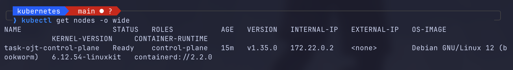
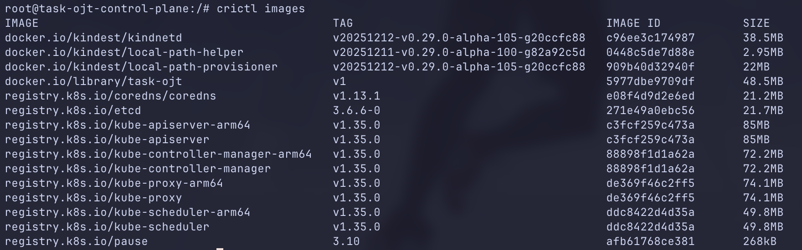
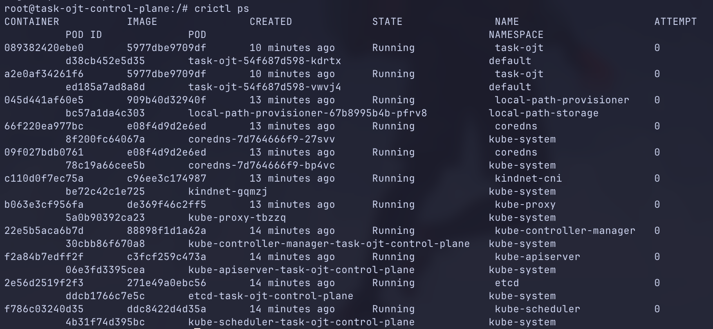
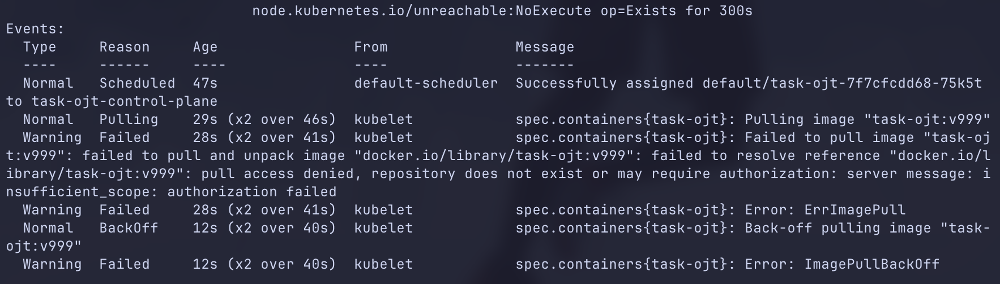
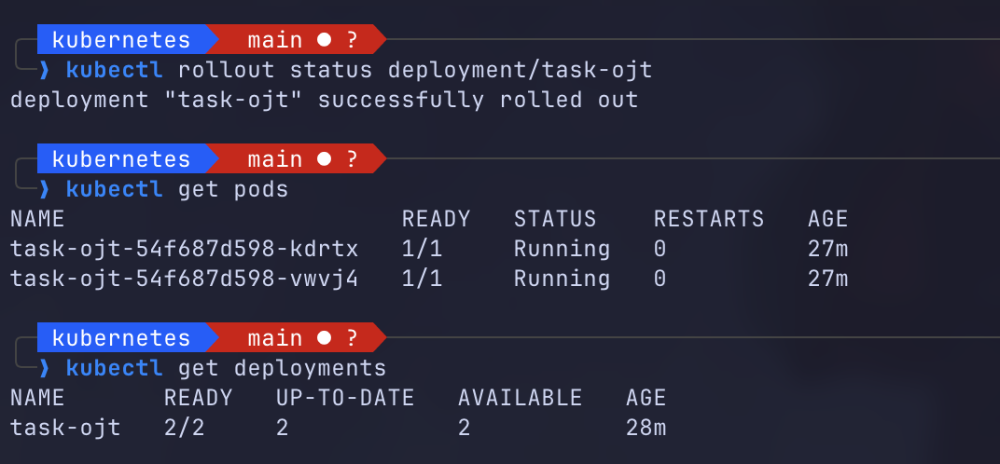
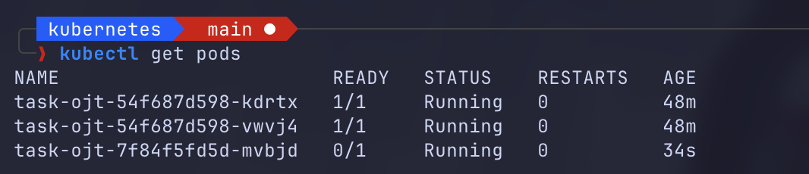
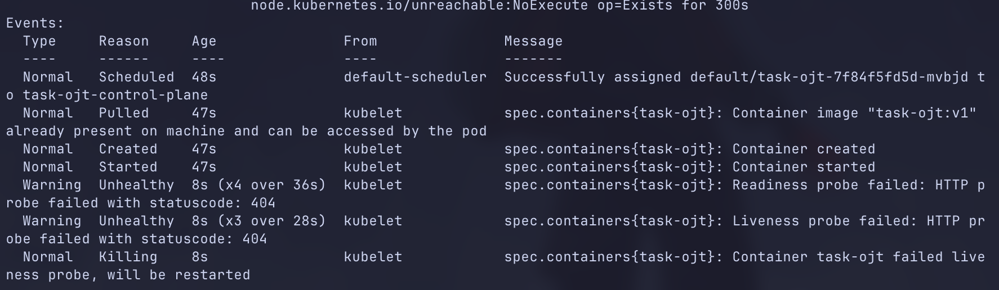
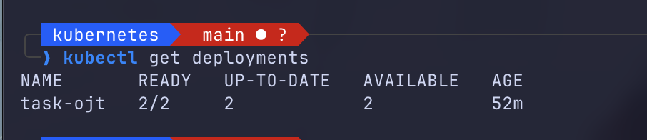
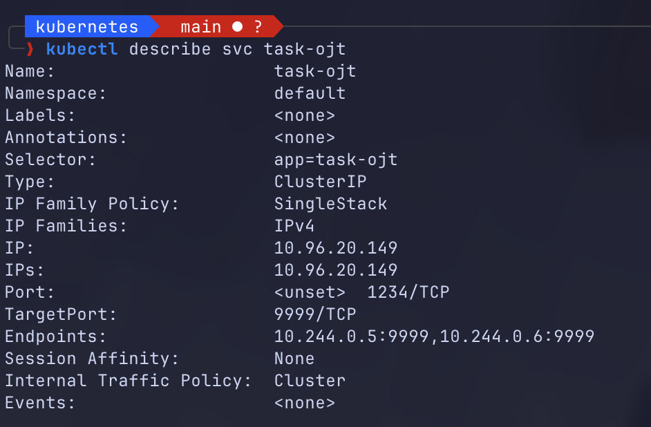

## docker image verification

```bash
$ docker images
```


```bash
$ docker ps
```


## kubernetes image verification

```bash
$ kubectl get pods 
```


```bash
$ kubectl get svc
```


```bash
$ kubectl get deployments 
```


```bash
$ kubectl get nodes -o wide
```


## crictl tool exploration

```bash
$ crictl images
```


```bash
$ crictl ps
```



## image error

```bash
$ kubectl get pods
```


```bash
$ kubectl describe pod task-ojt-7f7cfcdd68-75k5t
```


```bash
$ kubectl rollout status deployment/task-ojt
$ kubectl get pods
$ kubectl get deployments
```


## application health

```bash
$ kubectl get pods
```


```bash
$ kubectl describe pod task-ojt-7f84f5fd5d-mvbjd
```


```bash
$ kubectl get deployments
```


## service connectivity

```bash
$ kubectl describe svc task-ojt
```
